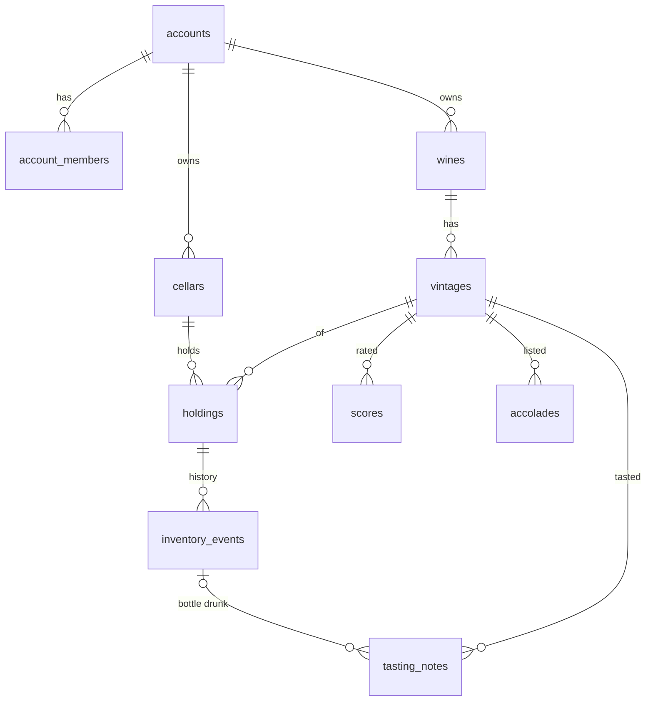

# Data model

The database is Postgres on Supabase. The schema lives in `supabase/migrations/` and is tested by `supabase/tests/schema_test.sql` (`npm run db:test`).

## Principles

- **Everything belongs to an account.** Every row carries `account_id`. Row-level security lets a signed-in user read the accounts they are a member of and change those where they are owner or editor. A new sign-up gets its own account automatically. v1 has one user (Dan), but a second user is walled off from day one.
- **No cross-account links.** Child rows reference parents by `(id, account_id)`, so a holding can never point at another account's wine, even though foreign-key checks bypass row-level security.
- **History, not overwrites.** Bottle counts change only by adding an `inventory_events` row. A trigger applies each event to its holding, and the holding's counts can't be edited directly. Events can't be deleted; mistakes are fixed with an `adjusted` event.
- **Physical bottles.** Counts are bottles, not 750 ml equivalents. Bottle size is a separate field (750 ml default), and anything else is flagged.
- **Keep what was written.** Scores keep their text (`94+`, `92-94`) beside the parsed numbers. Imported wine names keep the raw spreadsheet string.
- **Offline-ready.** Every table has a UUID primary key and `created_at`/`updated_at`, which is what PowerSync needs to sync an on-device copy.

## Entities

| Table              | One row is                                                                       | Key fields                                                                                                                                             |
| ------------------ | -------------------------------------------------------------------------------- | ------------------------------------------------------------------------------------------------------------------------------------------------------ |
| `accounts`         | A person or household                                                            | `name`                                                                                                                                                 |
| `account_members`  | A signed-in user's access to an account                                          | `user_id`, `role` (owner, editor, viewer)                                                                                                              |
| `cellars`          | A place bottles are kept (LA home, Oregon, Paris). No bins or racks.             | `name`, `location`, `country_code`, `currency`, `timezone`, `archived_at`                                                                              |
| `wines`            | A wine independent of vintage                                                    | `name`, `producer`, `cuvee`, `source_name`, `country`, `region`, `sub_region`, `appellation` (place laid out like CellarTracker: USA > California > Napa Valley > Oakville), `colour`, `grapes`, CellarTracker and Vinous ids                       |
| `vintages`         | One year of a wine (`year` null = non-vintage)                                   | `year`, `drink_from`, `drink_to`, `drink_window_source`                                                                                                |
| `holdings`         | Bottles of one vintage, in one cellar, in one size, from one purchase lot        | `bottle_size_ml`, `quantity` (in the cellar), `quantity_on_order`, `unit_price`, `currency`, `purchase_date`, `merchant`, `import_ref`                 |
| `inventory_events` | One change to a holding                                                          | `event_type`, `quantity_delta`, `on_order_delta`, `occurred_at` (null = unknown), `transfer_id`, `reason`, `note`                                      |
| `scores`           | A critic or community score                                                      | `source`, `source_detail`, `raw_value`, `value_low`, `value_high`, `is_plus`, `is_barrel_sample`, `reviewed_on`, critic `drink_from`/`drink_to`, `url` |
| `accolades`        | A list or award                                                                  | `raw_text`, `publication`, `title`, `rank`, `year`                                                                                                     |
| `tasting_notes`    | The user's own note, optionally tied to the bottle drunk                         | `tasted_on`, `rating` (out of 100), `maturity`, `notes`, `food_pairing`, `occasion`, `would_buy_again`                                                 |
| `cellar_inventory` | View: holdings joined to wine, vintage and cellar, with a size label. Obeys RLS. | `bottle_size_label`, `is_non_standard_size`                                                                                                            |

### Inventory events

| Event             | In cellar | On order | Use                                                              |
| ----------------- | --------- | -------- | ---------------------------------------------------------------- |
| `imported`        | + or 0    | + or 0   | Opening balance from the spreadsheet                             |
| `purchased`       | +         |          | Bottles arrived                                                  |
| `ordered`         |           | +        | Paid for, not delivered                                          |
| `delivered`       | +n        | −n       | An order arrives                                                 |
| `order_cancelled` |           | −        | An order won't arrive                                            |
| `consumed`        | −         |          | Drunk (a tasting note can link to it)                            |
| `removed`         | −         |          | Gift, sale, breakage (`reason`)                                  |
| `transfer_out`    | −         |          | Moved to another cellar; same `transfer_id` as the `transfer_in` |
| `transfer_in`     | +         |          | Moved from another cellar                                        |
| `adjusted`        | ±         | ±        | Stock-take correction                                            |

A count that would go below zero is rejected, so you can't drink a bottle you don't have.

### Score sources

`unknown` (the spreadsheet's generic score), `wine_advocate`, `vinous`, `cellartracker`, `wine_spectator`, `jancis_robinson`, `james_suckling`, `jeb_dunnuck`, `decanter`, `burghound`, `other` (named in `source_detail`). Scores out of 20 set `scale_max = 20`. Enrichment adds new score rows rather than overwriting imported ones.

## Spreadsheet mapping

This follows the field mapping in the Data Steward's audit of `My_Wine_Inventory.xlsx`. The importer is `tools/import/` (see its README): a dry run that writes a reconciliation report, then a one-transaction import that verifies its own counts.

| Sheet field                           | Goes to                                                                                                                                                       | Notes                                                                                        |
| ------------------------------------- | ------------------------------------------------------------------------------------------------------------------------------------------------------------- | -------------------------------------------------------------------------------------------- |
| Workbook owner                        | `accounts` (Dan's, made at sign-up)                                                                                                                           | One account.                                                                                 |
| Sheet NCP / O / Paris                 | `cellars`: LA home (USD), Oregon (USD), Paris (EUR)                                                                                                           | With `country_code` and `timezone`.                                                          |
| Section header rows (country)         | `wines.country`, and `wines.region` for US states                                                                                                             | Carried down. Oregon sheet: USA / Oregon. Header rows aren't imported.                       |
| Vintage (B)                           | `vintages.year`                                                                                                                                               | Null allowed for future NV wines.                                                            |
| Wine (C)                              | `wines.name`, `producer`, `cuvee`; raw string in `wines.source_name`                                                                                          | Trim whitespace. "1.5L" suffix goes to bottle size.                                          |
| Bottle size (Paris D, "1.5L" in name) | `holdings.bottle_size_ml`                                                                                                                                     | 750 default, 1500 when stated. Magnums show as flagged in `cellar_inventory`.                |
| Region (D / Paris E)                  | `wines.appellation` (and `region` where it's a broad region)                                                                                                  | Normalise spellings.                                                                         |
| RP (E / Paris F)                      | `scores`: `source = unknown`, `raw_value` as written, `value_low`, `value_high`, `is_plus`, `is_barrel_sample` for ranges, `entered_via = spreadsheet_import` | "94+" → 94 + plus flag. "92-94" → 92 to 94, barrel sample. Blank → no score row.             |
| Price (F / Paris G)                   | `holdings.unit_price`, `holdings.currency` (from the cellar)                                                                                                  | Formulas evaluated. 0 and blank → null (unknown, not free).                                  |
| QTY (G / Paris H)                     | `imported` event: `quantity_delta = QTY − FUTURE`, `on_order_delta = FUTURE`                                                                                  | QTY kept in `import_ref`.                                                                    |
| GONE (J / Paris K)                    | `consumed` event, `quantity_delta = −GONE`, `occurred_at` null                                                                                                | Dates unknown. Fully drunk lines (LA rows 195, 358) become holdings at 0 with their history. |
| LEFT (H / Paris I)                    | Not stored; it's `quantity + quantity_on_order`                                                                                                               | Checked against the sheet on import.                                                         |
| FUTURE (K / Paris L)                  | `holdings.quantity_on_order` via the `imported` event                                                                                                         | The 12 Truss 2024 bottles.                                                                   |
| TOTAL (I / Paris J)                   | Not stored; it's price × QTY                                                                                                                                  | Where typed over the formula, the typed value goes in `holdings.notes` and `import_ref`.     |
| Accolades (M / Paris U)               | `accolades`: `raw_text` plus parsed `publication`, `title`, `rank`, `year`                                                                                    | 15 lines.                                                                                    |
| Paris S (litres left)                 | Not stored                                                                                                                                                    | Derived from size × count.                                                                   |
| Paris hidden N–R, "\*" in A, O1 date  | Not stored as fields; kept in `import_ref` for the one row (56)                                                                                               | Looks like a market value; open question 9 for Dan.                                          |
| Summary rows                          | Not imported                                                                                                                                                  | Used only to reconcile counts.                                                               |
| Sheet name and row number             | `holdings.import_ref` (`{"sheet": "NCP", "row": 569, ...}`)                                                                                                   | Lets the dry-run report point at every line.                                                 |

Not in the sheet, left null for enrichment: colour, grapes, drinking windows, purchase date, merchant, critic per score.

### Counting on-order bottles

On the LA sheet, LEFT = QTY − GONE, so its 1,823 includes the 12 Truss bottles still on order. After import, LA shows `quantity` 1,811 in the cellar and `quantity_on_order` 12. The Checkpoint B reconciliation should compare LEFT with `quantity + quantity_on_order`.

## Later, without a redesign

- **Sharing an account** (a partner, a house manager): add `account_members` rows with editor or viewer roles.
- **A shared wine catalogue across users:** wines are per account in v1. A shared, read-only catalogue table can be added and linked from `wines`, using the CellarTracker and Vinous id columns that are already there.
- **Individual bottles** (bottle-level notes or locations): a `bottles` table under `holdings`.
